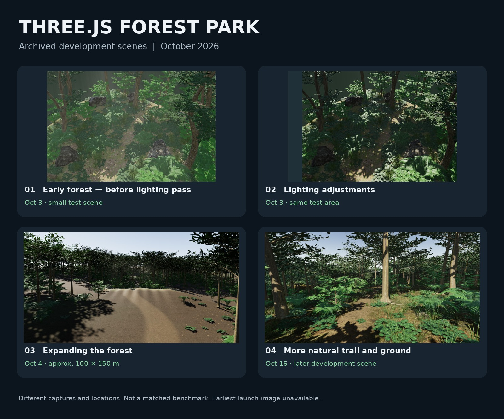

# 小さな森から1km四方へ — Three.js / WebGPU 森林公園の制作記録

**awasemisoによる開発記録（2026年）。** [English README](README.md)

UE5で森と山脈を制作する前に、RTX 5060 Laptop（8GB）のノートPC上で**Three.js r185・WebGPU・TSL**を使い森林公園を制作しました。最初は約11mの小区画で品質を確認し、その配置と雰囲気を維持しながら、約100×150mの連続森林から、約**1km×1kmの有限フィールド**へ拡張しました。15地点を巡る動作確認の記録があります。

自作のMarkdown文書は、[適用範囲](LICENSE_SCOPE.md)を明示したうえで[MITライセンス](LICENSE)で公開します。ただし、**画像・動画や第三者素材はMITの対象外**です。これは**開発記録の公開用リポジトリ**です。ゲームの全ソースコードや他社素材を配布するものではありません。

## 時系列

- **10月3日：** 小型森林の明暗・材質を調整。着手当初の起動画面は未発見。
- **10月4日：** 小区画の品質を守りながら、連続森林、1km四方へ拡張。固定乱数・描画集約・LODなどを検証。
- **10月7日：** ノートPCで広域1080p高画質テスト。枝葉・影の負荷が残り、全域60fpsには到達した記録がありません。
- **10月16日：** 道を均一に整地せず、石・草を残す自然な林床を改良。
- **10月17日：** 新PCへの受け渡し資料を作成。正確な機材切替日は未確定。

詳しくは [英語の開発年表](docs/DEVELOPMENT_TIMELINE.md)、[技術メモ](docs/TECHNICAL_NOTES.md)、[性能記録](docs/PERFORMANCE_AND_LIMITATIONS.md)、[失敗と改善](docs/FAILURES_AND_LESSONS.md) を参照してください。

## なぜ公開するのか

完成動画だけでは分からない、**小さな区画で試す → 見た目と性能を確認する → 良い変更だけ広い範囲に反映する**という工程を記録するためです。

UE5版は、このThree.js版を見本として提示してから**別実装としてゼロから制作**しました。コードの移植ではありません。UE5版の調査後に、制作工程・画質・性能を比較する予定です。

## 権利と検証上の留意点

ソースコード、3Dモデル、テクスチャ、第三者アセットの一式は掲載していません。画像中の第三者素材の権利は各権利者に帰属します。公開されているからといって自由に再配布できるわけではありません。

初期の画像の日付は保存資料の照合によるもので、厳密な撮影日メタデータではありません。また、比較画像は同じカメラ位置・品質条件の統一比較ではありません。詳細は [出典と公開範囲](docs/SOURCES_RIGHTS_AND_PROVENANCE.md) を参照してください。

## ソースコードの公開について

今回は**技術記録だけの公開**です。SamG-CoderなどのMIT公開に学び、今後は自作の森林描画コードについても第三者素材・著作権表示を確認してから、別途MIT公開を検討します。未確認の素材を一緒にアップロードせず、既存の制作プロジェクトを変更しません。詳細は[公開計画](docs/OPEN_SOURCE_RELEASE_PLAN.md)と[出典への謝辞](docs/ACKNOWLEDGMENTS.md)をご覧ください。