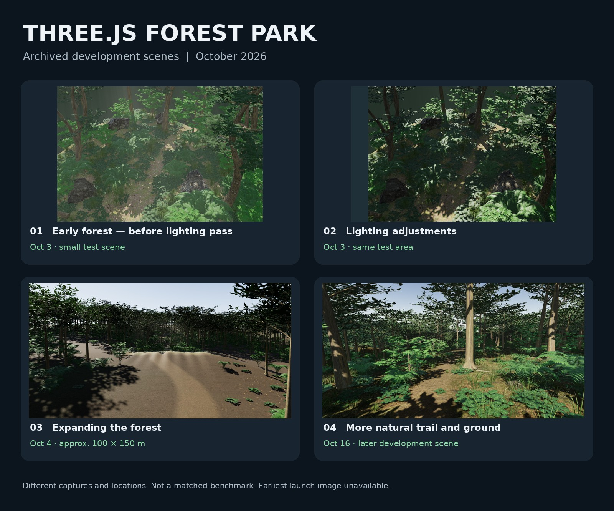

# From a small forest to a 1 km² world — Three.js / WebGPU Forest Park

**A public development record by awasemiso (2026).**

Before building a separate mountain/forest environment in Unreal Engine 5, I developed a forest park in **Three.js r185, WebGPU, and TSL** on an **RTX 5060 Laptop GPU (8 GB)**. A small forest was used as the visual baseline before extending the environment to an approximately **1 × 1 km finite world**, with **15 recorded walk-through checkpoints**.

This repository documents the **process and findings**, not the game source code. It includes archived images, technical notes, measurements, and unsuccessful experiments, rather than a claim that the whole world reached 60 fps.

**日本語版:** [README.ja.md](README.ja.md)

## Development timeline

| Date (2026) | What the records show |
|---|---|
| Oct 3 | Small forest (~11 m); lighting and material tuning. Earliest launch capture not found. |
| Oct 4 | Expanded through a ~100 × 150 m continuous forest and a finite ~1 × 1 km field; fixed-seed placement, batching, and level-of-detail work. |
| Oct 7 | Archived high-quality 1080p performance tests on the RTX 5060 Laptop show significant limitations across the larger world. |
| Oct 16 | Refined trails and forest-floor detail, retaining patches of grass and small rocks. |
| Oct 17 | Handoff documentation for work on a newer desktop PC. Exact hardware-transition date remains unverified. |

Details: [Development timeline](docs/DEVELOPMENT_TIMELINE.md).

## What was tested

- Procedural trees and vegetation mixed with third-party PBR materials.
- Maintaining the small original area's look while expanding into a larger forest.
- Fixed seeds, consistent placement, terrain-ground contact, batching and LOD.
- Water, mist, sunlight, God Rays, and other lighting treatments.
- Performance experiments that did **not** all improve performance.

Read [Technical notes](docs/TECHNICAL_NOTES.md) and [Failures and lessons](docs/FAILURES_AND_LESSONS.md).

## What the saved performance records actually show

| Scene / archived test | Approximate recorded result | Important condition |
|---|---:|---|
| Small forest, fixed view | **55.33 fps** | Oct 4, 1080p, RTX 5060 Laptop; headless single saved run |
| Small forest, rotating view | **56.78 fps** | Same small-forest test family |
| Large forest, forest interior | **16.5 fps** | Oct 7, 1080p/high quality; separate scene and test |
| Large forest, waterfall area | **21.3 fps** | Same large-world test family |
| Large forest, rotating view | **16.3 fps** | Same large-world test family |

These are **not matched A/B tests** and cannot be used as a direct engine-to-engine comparison. The large forest has **no verified all-area 60 fps result** in the saved records.

Full notes: [Performance and limitations](docs/PERFORMANCE_AND_LIMITATIONS.md).

## Image gallery

- [Early forest, before lighting tuning](images/01-archived-forest.jpg) — Oct 3, attributed from saved records
- [After lighting tuning](images/02-archived-forest.jpg) — Oct 3
- [Forest extension](images/03-archived-forest.jpg) — Oct 4
- [Natural trails / forest floor](images/04-archived-forest.jpg) — Oct 16

These images are extracted from an archived four-panel comparison board. **Their dates derive from saved reports and file timestamps**, not independently verified original camera metadata. They do not all have matching cameras or settings.

## Relationship to the UE5 project

The subsequent Unreal Engine 5 forest was **built separately from scratch**, with this Three.js project shown as a visual reference and a roughly 100 m initial test area. It was **not a code port**. A proper UE5 development history and controlled comparison will be documented separately once verified.

## Scope and rights

**Licensing:** Original Markdown documentation is available under the [MIT License](LICENSE), with the [license scope](LICENSE_SCOPE.md) explicitly excluding screenshots and third-party assets. **This is currently a documentation-only repository.** It does not contain runnable game code, complete assets, models, shaders, or texture packs. Some visible assets and materials are from third parties; those rights remain with their respective owners. **Do not assume that public visibility means permission to redistribute or reuse the media.** See [License scope](LICENSE_SCOPE.md), [Sources, rights, and provenance](docs/SOURCES_RIGHTS_AND_PROVENANCE.md), and [Acknowledgments](docs/ACKNOWLEDGMENTS.md).

*Prepared from source files, archived development reports, tests, and screenshots collected on Nov 4, 2026. The very first build date, first launch screenshot, and some historical details could not be confirmed.*

## Planned open-source code release

A reusable **MIT-licensed code sample** may follow after auditing the underlying forest implementation and third-party notices. No runnable forest game code is included here yet. See [the source-release checklist](docs/OPEN_SOURCE_RELEASE_PLAN.md).